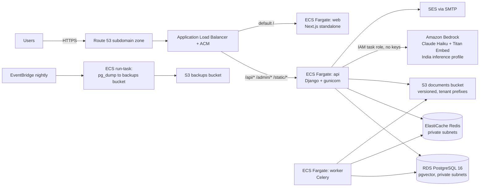

# Architecture

OpenVault: multi-tenant RAG knowledge base. The owner selects the AWS region
and new subdomain in `deploy.config`. ECS Fargate serves the frontend and API
from one origin so HttpOnly cookie sessions work.

The account-global GitHub OIDC provider and build/plan/apply roles live in
`infra/bootstrap`. Each environment owns only its scoped deploy role. Staging
is the default first deployment; production can be created after staging passes
its smoke test.

Staging defaults to the deterministic `fake` LLM provider and disables email
verification only for the documented staging signup test; it makes no Bedrock
calls. Production keeps Bedrock and email verification enabled.

The initial environment apply creates ECR repositories and ECS task/service
definitions with desired counts at zero. The first API/web images are built and
pushed only after ECR exists. Migrations and initial data setup run as one-off
tasks, then Terraform enables the services. No task tries to pull a missing
image.

## Request flow

1. Browser → Route 53 (subdomain zone delegated from the parent DNS) → ALB
   (TLS 1.3 via ACM) → path rules: `/api/*`, `/admin/*`, `/static/*` to the api
   service; everything else to the web service.
2. The api service (Django/gunicorn) authenticates via HttpOnly JWT cookies,
   enforces tenant isolation at the query layer (`company` FK everywhere),
   retrieves with hybrid BM25 + pgvector cosine (filtered by the caller's
   document ids), and streams the answer from Bedrock through Converse.
3. The worker (Celery + Redis) indexes documents: extract → chunk → embed
   (Titan v2, 1024 dims) → store chunks + vectors in Postgres.
4. AI calls authenticate with the **ECS task role** — no API keys anywhere.
   The task-role policy allows only the configured model/inference-profile ARNs.

## Data flow

* Documents: browser → presigned S3 PUT (or multipart through the api for
  small files) → S3 under `<company-slug>/…` → Celery task reads, extracts,
  chunks, embeds, writes `core_chunk` rows with `embedding_vec` (pgvector).
* Chat: question → retrieval (pgvector KNN over the caller's allowed document
  set, BM25 rerank on the shortlist) → prompt → Bedrock stream → NDJSON to the
  browser → AskLog row (per-company usage metering) + structured
  `llm_usage` log line (cost metric).

## Trust boundaries

| Boundary | Control |
|---|---|
| Internet → ALB | TLS 1.3, WAF-ready (add later), ALB SG only 80/443 |
| ALB → services | SG references only; api reachable only from the ALB SG |
| api/worker → data | RDS/Redis SGs accept only the app SGs; isolated private subnets |
| Tasks → AWS APIs | IAM task roles, least privilege: S3 prefixes, SSM `/openvault/<env>/*`, named Bedrock ARNs only |
| Tenant → tenant | Django query-layer isolation, tested by a 17-case isolation matrix; chunks carry `company` FK |
| Tenant admin → platform | BYO LLM `base_url` validated against private/metadata IPs (SSRF guard), https-only |
| CI → AWS | Bootstrap-owned GitHub OIDC provider; build trusts `main`, plan trusts pull requests, apply trusts protected environments, deploy trusts only its environment |

## Sizing reality

Initial running shape: API 0.5 vCPU/1 GiB, worker 0.25 vCPU/0.5 GiB, and web
0.25 vCPU/0.5 GiB. The API scales from one to three tasks at a 60% CPU target.
Local fake-provider tests are not ECS capacity measurements; AWS capacity is
**UNVERIFIED** until staging load tests are run. See `docs/loadtest-results.md`.
