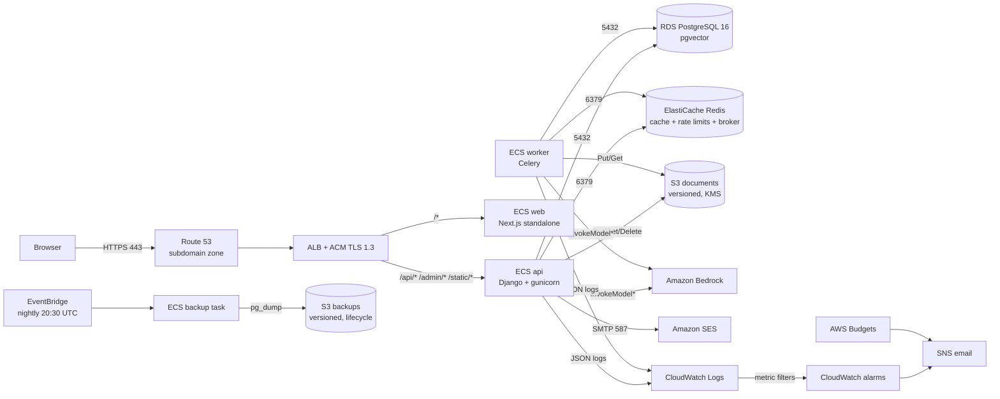

# Architecture — new AWS production stack

> **Scope:** this document describes the `infra/` stack on the `infra` branch.
> It is a **new subdomain** deployment. The live site at
> `openvault.saadops.site` / `api.saadops.site` (Amplify + Render) is not
> touched by this stack. Legacy notes are kept in `docs/aws/README.md` and
> `docs/deployment/amplify-render-cloudflare.md`.

## 1. One-paragraph summary

A single **ECS Fargate** cluster runs three services — `api` (Django +
gunicorn), `worker` (Celery), and `web` (Next.js standalone) — in two public
subnets in **ap-south-1**, behind one internet-facing **ALB** with an ACM
certificate. The ALB sends `/api/*`, `/admin/*`, and `/static/*` to the API and
everything else to the web container, so the browser sees **one origin** and
HttpOnly cookies work without cross-site configuration. **RDS PostgreSQL 16**
(pgvector) and **ElastiCache Redis** sit in isolated private subnets with no NAT
gateway. Documents, generated forms, and database dumps live in **S3**;
secrets live in **SSM SecureString**; Bedrock is reached through the **ECS task
role**, never a stored API key. GitHub Actions deploys through **OIDC** with
separate build, deploy, plan, and apply roles.

## 2. Request and data flow

### Why same-origin web + API

The app uses **HttpOnly, Secure, SameSite cookies** for access/refresh tokens.
If the frontend were on `www.example.com` and the API on
`api.example.com`, every fetch would need `credentials: 'include'`, a matching
CORS origin, and a cookie `Domain` policy — and third-party-cookie blocking can
still break it. Path routing on one ALB avoids that class of bugs. See
[ADR 0002](decisions/0002-same-origin-web-api.md).

### Streaming

`/api/ask` streams NDJSON. The ALB idle timeout and gunicorn timeout are both
**300 s**; ECS sends `SIGTERM` and gives the API container **120 s** to finish
in-flight streams. The web/API path is deliberately not buffered by a CDN.

## 3. Network

| Piece | Choice | Notes |
|---|---|---|
| VPC | `10.40.0.0/16`, 2 AZs | `infra/modules/network` |
| Public subnets | `10.40.0.0/20`, `10.40.16.0/20` | ALB **and** ECS tasks; tasks get public IPs for egress |
| Private subnets | `10.40.128.0/20`, `10.40.144.0/20` | RDS + ElastiCache only; no internet route |
| NAT | **None** | Cost decision; see ADR 0004 |
| Security groups | ALB → api/web; api+worker → RDS/Redis; no inbound to worker/RDS/Redis from the internet | Terraform owns them |

**No-NAT trade-off:** Fargate tasks in public subnets have public IPs and reach
Bedrock/S3/SES through the internet gateway. They are still protected by
security groups, and no inbound rule exposes them except the ALB on 8000/3000.
The alternative — private tasks + NAT gateway — adds roughly **$35–$45/mo**
per AZ. If a compliance requirement forbids public IPs on application tasks,
switch to private subnets + NAT (or VPC endpoints) deliberately; do not
half-change it.

## 4. Compute and process model

| Service | Image | Command | Scaling |
|---|---|---|---|
| `api` | `openvault-prod-api:<sha>` | gunicorn 2 workers × 4 threads, port 8000 | CPU target 60%, 1→3 tasks in prod; 1 in staging |
| `worker` | same API image | `celery -A config worker --concurrency=2` | fixed at 1; scale by queue length |
| `web` | `openvault-prod-web:<sha>` | Next.js standalone, port 3000 | 1 task; can scale later |
| `migrate` | same API image | one-off `python manage.py migrate` | run before every service update |
| `backup` | same API image | `/app/scripts/backup.sh` | EventBridge nightly; not a service |

The **migrate task is a separate task definition** and runs with the API image
before services are updated. Serving containers never run migrations. See
[ADR 0005](decisions/0005-one-off-migration-task.md).

`api` and `web` use ECS deployment circuit breaker with rollback. `api` has ECS
Exec enabled for break-glass debugging (audited). `web` and `worker` do not
expose a public port; only the ALB talks to `web`.

## 5. Data layer

* **RDS PostgreSQL 16** (`db.t4g.medium`, 25 GB gp3, single-AZ in prod):
  `rds.force_ssl=1`, storage encrypted, automated backups 14 days, deletion
  protection on, final snapshot on. Master password is managed by RDS in
  **Secrets Manager**; the app uses `DATABASE_URL` from SSM. pgvector is
  installed by `scripts/restore.sh` / migrations as needed.
* **ElastiCache Redis 7** (`cache.t4g.micro`, single node): at-rest encryption,
  snapshots retained; used for cache, Redis-backed per-user/plan rate limits,
  and the Celery broker. A single node is a known single point of failure at
  launch; Multi-AZ is a later upgrade.
* **S3 documents bucket:** versioned, SSE-KMS (AWS-managed key), public access
  blocked, TLS-only policy, access logging, CORS only for the app origin.
  Documents are per-tenant prefixes; generated forms use the same bucket under
  `forms/<user_id>/` via the storage abstraction, so ECS disk loss does not lose
  them.
* **S3 backups bucket:** versioned, lifecycle to Standard-IA after 30 days,
  expire after 90 days, noncurrent versions after 90 days. `pg_dump -Fc` dumps
  are written here by the nightly task.
* **No EFS.** ECS ephemeral disk is for code/temp only.

## 6. Security model

* **No static AWS keys in GitHub.** OIDC trust is restricted to the repository
  and each role trusts only its own context: build = `main`, plan =
  `pull_request`, deploy/apply = the matching `environment:` subject. Four
  roles: `github-build` (ECR push only), `github-deploy` (ECS update + ECR +
  logs + backup target), `github-terraform-plan` (read-only), and
  `github-terraform-apply` (PowerUser + project-scoped IAM, behind a
  required-reviewer environment).
* **Bedrock:** the ECS task role is the only credential. The IAM policy allows
  `bedrock:InvokeModel` and `InvokeModelWithResponseStream` only on the
  configured model/inference-profile ARNs. There is no `BEDROCK_API_KEY` on
  ECS; the optional variable is explicitly blank.
* **Secrets:** SSM SecureString under `/openvault/<env>/`; the ECS execution
  role can read only that path. Terraform state does not contain secret values.
* **Tenant keys:** BYO provider keys are encrypted at rest with
  `LLM_KEY_ENCRYPTION_KEY`; that key is in SSM and must be backed up separately.
* **Edge:** TLS 1.3/1.2 policy, HTTP→HTTPS redirect, ALB drops invalid headers,
  access logs to S3. No WAF/Shield Advanced at launch (cost); the app has
  authentication, CSRF/CORS controls, upload limits, and SSRF protections with
  tests.

## 7. Observability and cost controls

* JSON logs include `event`, `company_id`, `model`, `provider`,
  `input_tokens`, `output_tokens`, `total_tokens` for `llm_usage`; no prompt or
  document content.
* CloudWatch metric filters: `LLMInputTokens`, `LLMOutputTokens`,
  `LLMTotalTokens`, `LLMErrors`.
* Alarms: daily token guard, LLM errors, ALB 5xx, ALB unhealthy targets, ECS
  service no-datapoints, RDS CPU/storage/connections. SNS email subscription
  must be confirmed.
* AWS Budgets: absolute monthly thresholds **$20/$35/$50/$100** in prod and
  **$10/$15** in staging. These are guardrails, not forecasts. See
  [`COST.md`](COST.md).

## 8. Deployment lifecycle

1. Pull request → `ci.yml` (lint, tests, gitleaks, Docker build + Trivy,
   Terraform fmt/validate/tflint/checkov) and `terraform-plan.yml` (read-only
   plan comments).
2. Merge to `main` → `deploy.yml` builds images once, pushes the same SHA to
   both ECR repos, deploys **staging** automatically.
3. Production job waits for the protected `production` environment approval.
4. `scripts/deploy_ecs.sh` registers task-definition revisions, runs the
   **migrate** task, updates api/worker/web, waits for stability, runs the smoke
   test, and rolls back to the previous revisions on failure.
5. Rollback is a manual workflow (`rollback.yml`) with `SKIP_MIGRATE=1`; the
   database schema is forward-only in practice.

## 9. Failure domains and recovery

| Failure | Impact | Recovery |
|---|---|---|
| One API task dies | ALB routes to remaining task; deploy circuit breaker replaces it | ECS self-heals; `service-not-starting.md` |
| RDS unavailable | API health 503, logins/uploads fail | RDS restart/PITR; `database-down.md`, `restore.md` |
| Redis unavailable | Rate limits/cache/Celery degrade; API may still answer | Restart/replace node; `database-down.md` |
| Bedrock down/quota | Answers fail; retrieval may still show sources | `ai-provider-down.md` |
| Bad image | Circuit breaker / rollback | `bad-deploy-rollback.md` |
| AZ failure | Single-AZ RDS and Redis are affected | Restore/recreate; multi-AZ is the real fix |

RPO/RTO: RDS PITR ~5 min / 30–60 min (UNVERIFIED until measured); nightly
logical dumps have a 24 h RPO. No cross-region DR.

## 10. Deliberate non-goals / open items

* No CloudFront/WAF, no multi-region, no NAT, no EFS, no Multi-AZ RDS/Redis.
* `EMBED_DIM=1024` must match the Titan v2 embedding model; **UNVERIFIED**
  until `check_embeddings` is run against the real Bedrock model.
* Bedrock model access, inference-profile ARNs, and `ap-south-1` availability
  are **UNVERIFIED** without the AWS account.
* `container_insights=false`; the ECS no-datapoints alarm is a coarse proxy,
  not a substitute for Container Insights.
