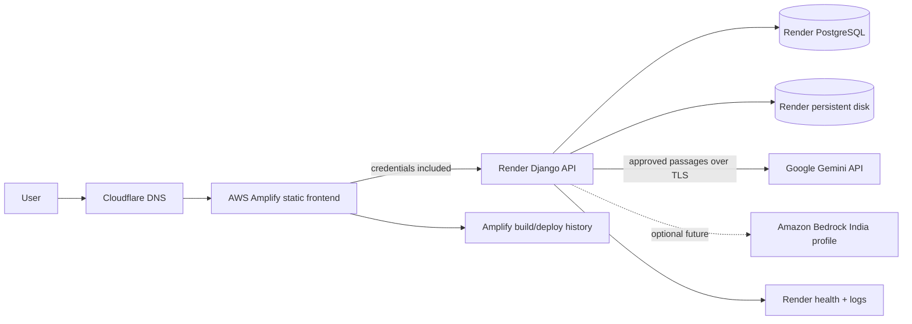

# OpenVault AWS services and AWS-native alternative

> **Current deployment choice:** AWS Amplify serves the statically exported
> frontend; Render hosts the Django API, PostgreSQL, and persistent document
> disk in Singapore; Google Gemini provides model inference for the initial
> launch; Cloudflare manages DNS. Amazon Bedrock is retained as the future
> AWS-native inference option. Render bills are separate from AWS and are
> **not covered by AWS Activate credits**. The ECS/RDS/EFS inventory and cost
> model below are an optional future all-AWS alternative, not the selected
> launch deployment.

## Executive summary

The current launch uses AWS for frontend distribution and Google Gemini for
managed AI, while Render provides the stateful API/data layer. This hybrid is
smaller to operate for the first users, but it does not place all application
data in AWS or in India. If the product later needs an all-AWS data plane, use
the optional ECS/RDS/EFS alternative described below and migrate files
deliberately.

## Request and data flow

The browser calls `https://api.saadops.site` directly; the API is not proxied
through Amplify. CORS/CSRF allow only `https://openvault.saadops.site`. Render
PostgreSQL should use its internal connection string, and the document disk is
single-instance storage. The model provider receives only permission-approved
passages; the initial launch uses Gemini, while the optional Bedrock migration
applies the same rule. Because the API/data live in Render Singapore, do not
claim that all stored application data is in AWS India.

## Current launch services

| Layer | Service | Responsibility |
| --- | --- | --- |
| DNS | Cloudflare | DNS records for `openvault.saadops.site` and `api.saadops.site`. |
| Frontend | AWS Amplify Hosting (static export) | Build and globally serve the Next.js `out/` site. |
| API | Render Web Service | Run Django/Gunicorn; use the provided health endpoint. |
| Database | Render PostgreSQL | Store users, organizations, permissions, and audit events. |
| Uploads | Render persistent disk | Preserve filesystem-backed documents and generated forms for the single-instance launch. |
| AI | Google Gemini | `gemini-2.5-flash` chat + `gemini-embedding-001` embeddings for the initial launch. The API key stays in a Render secret. Bedrock remains the future AWS-native option. |
| Email | Amazon SES (planned) | Transactional verification/reset email after domain verification and SES production access. |

### Important limit of the Render disk

Render persistent disks are attached to one service instance. They prevent
horizontal scaling and zero-downtime deploys. Use them only for the initial
small workload. Before adding API replicas, migrate documents to shared object
storage (for example S3/R2) and test a tenant-safe migration/restore.

## Optional future all-AWS alternative inventory

| Plane | Services | Purpose |
| --- | --- | --- |
| Account and access | AWS Organizations (optional initially), IAM Identity Center, IAM roles, AWS Budgets | Separate human access from workloads; use task roles and budget alerts, never committed AWS keys. |
| Network | VPC, two Availability Zones, public/private subnets, route tables, internet gateway, NAT gateways, security groups | Put only the load balancer in public subnets; keep app and data services private. |
| Edge and TLS | Route 53, CloudFront, AWS WAF, ACM, Application Load Balancer | DNS, TLS, edge protections, static caching, and health-checked routing. ACM certificates for CloudFront are provisioned in `us-east-1`; the ALB certificate is in `ap-south-1`. |
| Compute and deploy | ECS cluster, ECS Fargate services, ECR, task execution/task roles, GitHub Actions OIDC | Run web, API, and background worker containers without managing hosts; deploy without long-lived CI credentials. |
| Relational data | RDS for PostgreSQL, automated backups, Performance Insights as needed | Store organizations, users, permissions, and audit records. Use Multi-AZ for production. |
| Cache | ElastiCache Valkey | Rate-limit/cache support for multi-process production deployments. |
| Files and keys | EFS, S3, KMS, AWS Backup | EFS for the app's current filesystem-backed documents; S3 for backup/log artifacts; KMS for encryption keys. |
| AI | Amazon Bedrock Runtime, model access, India inference profile, task IAM role | Invoke Claude Haiku 4.5 and Titan Text Embeddings V2 without embedding AWS credentials in code. |
| Monitoring and security | CloudWatch Logs/alarms/dashboards, CloudTrail, GuardDuty, AWS Config, Secrets Manager | Observe service health, record AWS changes, detect threats/config drift, and keep secrets outside images and source. |
| Email | Amazon SES | Transactional email such as account verification and recovery; request production sending access before launch. |

### Runtime layout for the optional AWS-native alternative

- **Web:** Next.js standalone container on ECS Fargate.
- **API:** Django/Gunicorn container on ECS Fargate.
- **Worker:** background document/OCR/indexing worker; begin with a small task
  and scale independently from the API.
- **Database:** RDS PostgreSQL. Use Multi-AZ and point-in-time recovery for the
  production profile.
- **Document filesystem:** EFS mounted by the app/worker because the current
  application writes files to a filesystem. Do not describe these files as
  already stored in S3. Move to S3 only after the application storage adapter
  supports it and migration/permission behavior is tested.
- **Session/cache/rate limiting:** ElastiCache Valkey in production; ensure all
  app replicas share the same cache/session configuration.
- **Secrets:** inject Django `SECRET_KEY`, database credentials, encryption
  keys, and any provider secrets from Secrets Manager at task startup. Do not
  bake them into images or commit `.env` files.

## Optional all-AWS alternative: monthly cost model

These are planning estimates for a possible future all-AWS migration. They are
**not the cost of the selected Amplify + Render deployment**. They use USD
prices for **October 2026**, AWS public
On-Demand list prices for `ap-south-1`, 730 hours per month, ARM64 Fargate, and
the traffic/storage assumptions listed below. They exclude tax, AWS Support,
domain purchase, one-time migration, unusual data transfer, and optional
PrivateLink endpoints. NAT, GuardDuty, WAF, CloudWatch, and backup spend is
usage-sensitive; confirm the final design in the AWS Pricing Calculator before
provisioning.

### Pilot: small live workload, limited redundancy

Assumptions: one small web task, one API task, one worker task (about 1.25 vCPU
and 2.5 GB RAM combined); one NAT gateway; single-AZ `db.t4g.micro` RDS with
50 GB gp3; one `cache.t4g.micro`; 50 GB EFS; 50 GB S3; 100 GB CloudFront data
out and about 1 million HTTPS requests; 3 WAF rules; 10 GB CloudWatch log
ingestion; modest audit/security usage. This is a cost-conscious pilot, **not**
the high-availability profile.

| Service group | Monthly estimate |
| --- | ---: |
| Fargate web, API, worker | $26.50 |
| Application Load Balancer and light LCU use | $20.80 |
| One NAT gateway and 50 GB processed | $43.70 |
| RDS PostgreSQL `db.t4g.micro` + 50 GB gp3 | $21.90 |
| ElastiCache Valkey `cache.t4g.micro` | $11.70 |
| EFS Standard, 50 GB | $16.50 |
| S3, 50 GB plus modest requests | $2.30 |
| CloudFront, 100 GB India data out + 1M HTTPS requests | $12.10 |
| WAF, one ACL, 3 rules, about 1M requests | $8.60 |
| Route 53, KMS, Secrets Manager | $4.70 |
| CloudWatch, CloudTrail, GuardDuty, AWS Config | $22.60 |
| AWS Backup, ECR, SES | $6.50 |
| **Pilot infrastructure subtotal** | **about $198/month** |

### Production: two-AZ application and Multi-AZ database

Assumptions: web and API scaled to two small tasks each plus one worker (about
2.25 vCPU and 4.5 GB RAM combined); two NAT gateways; Multi-AZ `db.t4g.small`
with 100 GB gp3; two small Valkey nodes; 100 GB EFS; 100 GB S3; 500 GB
CloudFront India data out and roughly 5 million HTTPS requests; more logs,
alarms, backups, and security telemetry.

| Service group | Monthly estimate |
| --- | ---: |
| Fargate web, API, worker | $47.70 |
| Application Load Balancer and about 1 average LCU | $23.30 |
| Two NAT gateways and about 100 GB processed | $87.40 |
| Multi-AZ RDS PostgreSQL `db.t4g.small`, 100 GB gp3 and backup allowance | $92.00 |
| Two ElastiCache Valkey `cache.t4g.micro` nodes | $23.40 |
| EFS Standard, 100 GB | $33.00 |
| S3, 100 GB plus requests | $4.50 |
| CloudFront, 500 GB India data out + HTTPS requests | $60.50 |
| WAF, one ACL, managed rules, request allowance | $10.00 |
| Route 53, KMS, Secrets Manager | $5.50 |
| CloudWatch, CloudTrail, GuardDuty, AWS Config | $41.30 |
| AWS Backup, ECR, SES | $12.00 |
| **Production infrastructure subtotal** | **about $441/month** |

### Bedrock is variable usage, not a fixed server

The modeled Claude Haiku 4.5 price in Mumbai is **$1.10 per million input
tokens** and **$5.50 per million output tokens**. For planning, assume 3,000
input tokens and 500 output tokens per question, plus a small Titan embedding
allowance:

| Monthly volume | Chat-token estimate | With small embedding allowance |
| ---: | ---: | ---: |
| 1,000 questions | $6.05 | about $6.10 |
| 5,000 questions | $30.25 | about $31 |
| 10,000 questions | $60.50 | about $61 |
| 20,000 questions | $121.00 | about $122 |

Actual cost depends on context length, answer length, caching, and model choice.
Permission-filtered retrieval should send only necessary passages, which also
keeps token spend down.

### Credit runway

With the selected hybrid, eligible AWS spend is primarily Amplify hosting/build
usage and Bedrock tokens. Render's API, Postgres, and persistent-disk invoices
are billed by Render and cannot be offset with AWS credits. Forecast Amplify
traffic/build minutes and Bedrock tokens separately before describing a credit
runway or amount in an AWS application. The Bedrock token examples above remain
usage estimates; use the AWS Pricing Calculator for Amplify and confirm credit
eligibility in the AWS Billing console.

## Deployment order for the optional all-AWS alternative

1. Create/secure the AWS account: MFA, IAM Identity Center, billing alerts,
   least-privilege admin access, and AWS Budgets at 50%, 80%, and 100% of the
   monthly cap.
2. Create the VPC across two Availability Zones. Add public subnets for the
   load balancer and private subnets for tasks/data. Configure NAT and security
   groups with explicit source/destination rules.
3. Create KMS keys, Secrets Manager secrets, ECR repositories, RDS, Valkey, and
   EFS. Turn on encryption, automated backups, and deletion protection for
   production data stores.
4. Create ECS cluster, task definitions, task roles, services, health checks,
   autoscaling, and CloudWatch alarms. Use GitHub Actions OIDC for deployment;
   do not use a permanent CI access key.
5. Configure Route 53, ACM, CloudFront, WAF, and ALB. Set authenticated routes
   and document downloads to bypass caching.
6. Enable CloudTrail, GuardDuty, AWS Config, and log retention. Send test
   alerts to the operations mailbox.
7. Enable Bedrock model access in the target account; attach `bedrock:InvokeModel`
   permissions to the ECS task role and test the India inference profile.
8. Request SES production access, validate domain identity, configure SPF/DKIM,
   and test verification/recovery mail.
9. Run restore drills for PostgreSQL and EFS, test a rollback, and verify that
   one tenant cannot retrieve another tenant's documents before launch.

## Cost controls and production gates

- Start with the pilot only if its single-AZ database and single NAT egress
  limitations are accepted. Move to the production profile before promising
  high availability.
- Add lifecycle policies for old S3 objects and EFS files only after retention
  requirements are defined. EFS Infrequent Access can reduce storage charges
  for cold documents, but adds retrieval charges.
- Set per-tenant AI limits, maximum output tokens, and usage reporting. Alert
  on Bedrock spend and set an AWS Budget for the account.
- Keep private document downloads out of CloudFront cache. Cache only versioned
  public static assets.
- Test that backups can be restored; a configured backup job alone is not a
  recovery plan.
- Add a Bedrock Runtime VPC endpoint if private service connectivity is a
  requirement. Its hourly endpoint and data-processing charges are not included
  in the totals above; use the Pricing Calculator for the chosen AZ count.

## Pricing references

Rates were checked against the AWS Price List for Mumbai on 2026-10-23. Main
inputs: Fargate ARM64 `$0.02383/vCPU-hour` and `$0.00261/GB-hour`; RDS
`db.t4g.micro` `$0.021/hour` and `db.t4g.small` `$0.042/hour` before Multi-AZ;
gp3 `$0.131/GB-month` per single-AZ allocation; EFS Standard `$0.33/GB-month`;
S3 Standard `$0.025/GB-month`; Valkey `cache.t4g.micro` `$0.016/hour`; NAT
gateway budget rate `$0.056/hour` plus `$0.056/GB` processed; CloudFront India
data out `$0.109/GB` for the first 10 TB and HTTPS requests `$0.012/10,000`;
Claude Haiku 4.5 `$1.10/$5.50` per million input/output tokens. AWS prices,
regional availability, model access, and credit eligibility can change; verify
before creating resources. Recheck the assumptions in the [AWS Pricing
Calculator](https://calculator.aws/) and the current [Fargate](https://aws.amazon.com/fargate/pricing/),
[RDS](https://aws.amazon.com/rds/postgresql/pricing/),
[EFS](https://aws.amazon.com/efs/pricing/),
[CloudFront](https://aws.amazon.com/cloudfront/pricing/),
[WAF](https://aws.amazon.com/waf/pricing/), and
[Bedrock](https://aws.amazon.com/bedrock/pricing/) pricing pages.

## Related docs

- [Bedrock keys, IAM, and model setup](./bedrock.md)
- [AWS Activate application draft](./activate-application.md)
