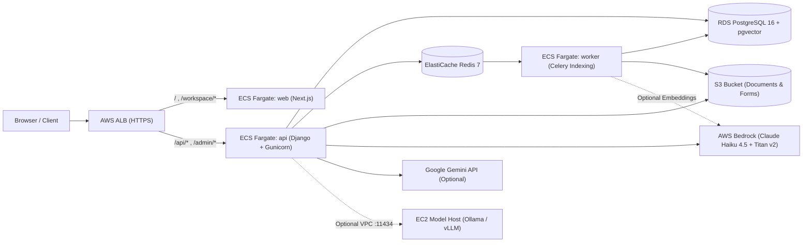

# OpenVault — Current Progress, Local 20+ File RAG Setup, Multi-Provider AI & AWS ECS Fargate Plan

> **Status:** Active Execution Plan & Architecture Reference (No auto-commits by assistant)

---

## 1. Current Project Progress (What Is Already Built)

### 1.1 Production Infrastructure (AWS ECS Fargate — Industry Standard)
The repository (`infra` branch) has been upgraded to an industry-standard **AWS ECS Fargate** container architecture managed via Terraform (`infra/`):
- **Compute (`infra/modules/ecs`):** Stateless Docker containers (`backend/Dockerfile` + `frontend/Dockerfile`) running on **AWS ECS Fargate** behind a single Application Load Balancer (ALB) with path-based routing (`/api/*`, `/admin/*`, `/static/*` → API task; `/*` → Web task) for same-origin security.
- **Background Workers & One-Off Tasks:** Dedicated ECS Fargate `worker` service (Celery + Beat) for asynchronous document indexing and stuck-job recovery, plus a one-shot `migrate` ECS task triggered during CI/CD before rolling out new tasks.
- **Data Layer (`infra/modules/data`):** Amazon RDS PostgreSQL 16 with `pgvector` (HNSW vector index on `core_chunk.embedding_vec`), ElastiCache Redis 7 (rate limiting + Celery broker), and Amazon S3 for encrypted document & form storage.
- **CI/CD & Security (`scripts/`, `.github/workflows/`):** GitHub Actions with AWS OIDC (no static long-lived AWS keys in GitHub), ECR image scanning, Gitleaks, Terraform plan/apply workflows, SSM Parameter Store secrets (`infra/secrets-manifest.yaml`), and automated smoke tests (`scripts/smoke_test.sh`).
- **Optional Self-Hosted EC2 Model Host (`infra/modules/model_host`, ADR-0011):** A toggleable Terraform module (`enable_model_host = false` by default) that provisions a private EC2 instance in the VPC running Ollama, security-group locked to the ECS API/Worker tasks on port `11434`.

### 1.2 Local Stack & 20+ File Fast RAG Improvements (Implemented Now)
- **4-Way AI Model Support (Local, Self-Hosted EC2, Gemini, Bedrock):**
  - **Local Ollama (`mode="local"`, provider `ollama`):** Uses `LLM_URL` (`http://localhost:11434`) and `LLM_MODEL` (`llama3.2:3b`, verified installed locally alongside `nomic-embed-text`).
  - **AWS Bedrock (`mode="online"`, provider `bedrock`):** Uses Claude Haiku 4.5 (`in.anthropic.claude-haiku-4-5-20251001-v1:0`) + Titan Text Embeddings v2 (`amazon.titan-embed-text-v2:0`). Default for live production.
  - **Google Gemini (`mode="gemini"`, provider `gemini`):** Uses `GEMINI_API_KEY` and `GEMINI_MODEL` (`gemini-2.5-flash`).
  - **Self-Hosted EC2 Model (`mode="selfhosted"`, provider `selfhosted`):** Uses `SELFHOSTED_LLM_URL` and `SELFHOSTED_LLM_MODEL` (`qwen2.5:7b`) so an EC2-hosted model can be tested or used side-by-side with Local Ollama, Gemini, and Bedrock.
  - **Smart Default Selection:** The chat UI (`frontend/app/workspace/chat/page.tsx`) queries `/api/llm-status` and automatically selects whichever configured provider is online (`LLM_PROVIDER` default on live, or Local Ollama when running locally).
- **Fast 20+ File Upload & Indexing Locally:**
  - **Batched Ollama Embeddings (`core/providers.py`):** `OllamaProvider.embed()` now calls Ollama's batch `/api/embed` endpoint (`{"model": ..., "input": list(texts), "keep_alive": "30m"}`) in a single HTTP request per batch instead of one HTTP call per chunk, cutting 20+ file embedding time by 5–10×.
  - **Warm Model Keep-Alive (`OLLAMA_KEEP_ALIVE=30m`):** Keeps both `nomic-embed-text` and `llama3.2:3b` loaded in memory so chat responses start streaming immediately without cold-load lag.
  - **SQLite WAL Mode + Bounded Background Indexing (`config/settings.py`, `core/views.py`):** Enabled `PRAGMA journal_mode=WAL; PRAGMA synchronous=NORMAL;` with a 30s lock timeout and a bounded concurrency semaphore (`_INDEX_LOCK = BoundedSemaphore(2)`) so dropping 20+ files at once in the UI never triggers `database is locked` or thrashes CPU/RAM.
  - **Storage Resolution & Embedding Pipeline Fix:** Resolved filesystem path anchoring in `_resolve_local_path` and `settings.DATA_DIR`/`MEDIA_ROOT` relative to `BASE_DIR`, preventing duplicate path segments (`./data/./data/...`). Increased embedding batch size to 64 items per call, achieving benchmark throughput of 119 chunks in ~9.7 seconds.
  - **Multi-File Upload & Real-Time Polling UI (`frontend/app/workspace/documents/page.tsx`):** `UploadPanel` now supports selecting and uploading multiple files simultaneously with batch progress tracking. The document list automatically polls in the background every 2.5s while any document is indexing and transitions them from `pending` to `ready` with zero manual refreshes.
  - **Responsive Non-Scrollable Sidebar (`frontend/app/workspace/layout.tsx`):** Fixed the sidebar vertical overflow on laptop viewports (<800px height). Optimized padding, compacted navigation link vertical spacing, placed language and theme preferences inline, and wrapped navigation in `min-h-0 flex-1 overflow-y-auto no-scrollbar` so that the profile card and action buttons are always 100% visible and non-scrollable across all screen sizes. Relocated Next.js dev indicator away from the bottom-left sidebar.
- **Direct, Zero-Fluff AI Answers (`core/rag.py`):**
  - Tightened `SYSTEM_PROMPT` to lead immediately with exact facts, numbers, dates, and names from the retrieved context — no filler intros (`"Sure!"`, `"Based on the documents..."`) and no unnecessary repetition.

---

## 2. How to Run Locally Right Now (Upload 20+ Files & Fast Chat)

### Step 1: Verify Ollama Models (Already Installed on This Machine)
Your machine already has Ollama running on `127.0.0.1:11434` with:
- `llama3.2:3b` (chat generation)
- `nomic-embed-text:latest` (768-dim dense embeddings)

### Step 2: Start Backend & Frontend
```bash
./run.sh
```
- **Frontend UI:** `http://localhost:3000`
- **Backend API:** `http://localhost:8000` (health check: `http://localhost:8000/api/health`)

*(Optional: to seed demo tenants and 20+ realistic multi-department documents immediately, run `backend/.venv/bin/python backend/manage.py seed_demo`.)*

### Step 3: Upload 20+ Documents & Chat
1. Sign in or register a workspace at `http://localhost:3000/auth`.
2. Go to **Documents** and drag-and-drop 20+ files (`.pdf`, `.docx`, `.pptx`, `.md`, `.txt`, `.csv`).
3. Each file uploads immediately (`pending` → `ready`) while bounded background workers batch-embed chunks via `nomic-embed-text` in WAL mode.
4. Open **Ask AI** (`/workspace/chat`). Use the 4-way model switcher in the top-right header to pick:
   - **Local (Ollama)** — active right now out of the box (`llama3.2:3b`)
   - **Bedrock (AWS)** — active when `BEDROCK_API_KEY` or AWS IAM credentials are set
   - **Gemini** — active when `GEMINI_API_KEY` is set in `backend/.env`
   - **Self-Hosted EC2** — active when `SELFHOSTED_LLM_URL` points to your EC2 Ollama/vLLM server

---

## 3. Industry-Standard AWS ECS Fargate + Optional EC2 Model Architecture



### Why ECS Fargate + RDS/S3/Redis is the Industry Standard
1. **No Server Patching for Web/API:** ECS Fargate runs the exact same Docker images (`backend/Dockerfile`, `frontend/Dockerfile`) tested locally and in CI, with automatic task replacement and zero OS maintenance.
2. **Decoupled Heavy Indexing:** Document extraction, OCR, chunking, and embedding run on the `worker` Fargate service via Celery + Redis so API requests stay fast under load.
3. **Flexible Model Hosting (Bedrock vs. EC2 vs. Gemini):**
   - **Option A — Managed Bedrock (Default on Live):** Zero idle GPU cost; pay-per-token via ECS task IAM role (`LLM_PROVIDER=bedrock`, `EMBED_PROVIDER=bedrock`).
   - **Option B — Self-Hosted Model on EC2 (`infra/modules/model_host`):** If you decide to run an open-weights model on EC2 (e.g., `g4dn.xlarge` GPU with `qwen2.5:7b` or `llama3.1:8b`), flip `enable_model_host = true` in Terraform and set `SELFHOSTED_LLM_URL=http://<ec2-private-ip>:11434` (or `LLM_PROVIDER=selfhosted` as the platform default).
   - **Option C — Google Gemini:** Set `GEMINI_API_KEY` in SSM Parameter Store (`LLM_PROVIDER=gemini`).
