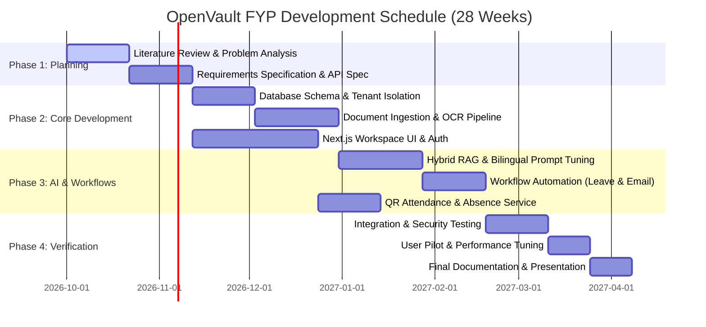
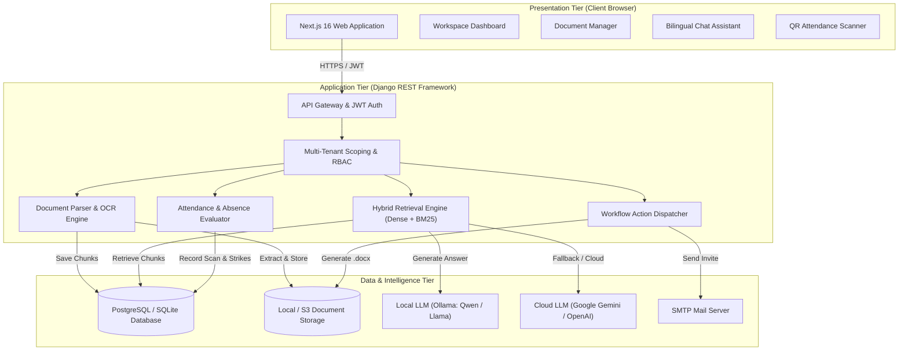
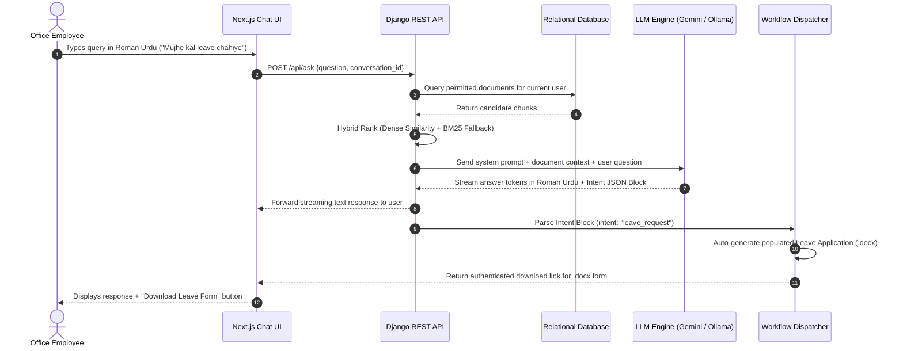
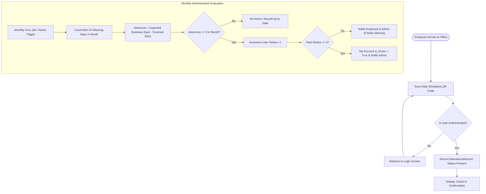
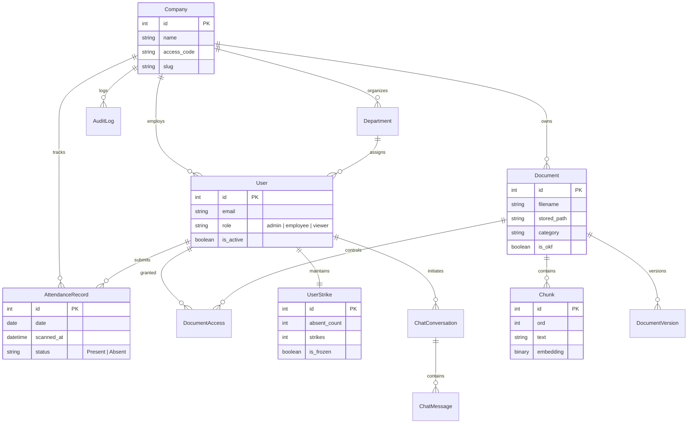

# UNIVERSITY OF SOUTH ASIA
### Department of Software Engineering
## FINAL YEAR PROJECT PROPOSAL

---

**Project Title:** OpenVault: A Multi-Tenant Workplace Knowledge Assistant with Bilingual RAG, Attendance Tracking, and Automated Workflow Management  
**Domain:** Applied Artificial Intelligence / Enterprise Information Systems / Natural Language Processing  
**Project Split:** Next.js Web Workspace · Django REST Backend API · Bilingual RAG & Workflow Automation Engine  

**Submitted by:**  
- Student Name 1 [Roll No / ID]  
- Student Name 2 [Roll No / ID]  
- Student Name 3 [Roll No / ID]  

**Degree Program:** BS Software Engineering (2023–2027)  
**Supervisor:** [Supervisor Name]  

---

## 1. Background

Small and medium-sized organizations in Pakistan often struggle with fragmented internal communication and administrative overhead. Company policies, employee handbooks, onboarding guides, and standard operating procedures (SOPs) are commonly scattered across email threads, WhatsApp groups, shared network drives, and printed paper folders. When staff members need answers to basic questions—such as leave entitlements, travel reimbursement limits, or meeting room bookings—they must either search through multiple files manually or ask administrative staff repeatedly.

In addition, standard day-to-day office tasks remain disconnected from one another. Attendance is often recorded on physical registers or isolated biometric devices that do not link to employee records. Leave applications require staff to manually draft documents or find blank templates, print them, and submit them in person. Meeting coordination requires switching between chat applications, email clients, and calendars.

A further operational challenge in local organizations is language. Most formal company policies and training manuals are written in formal English. However, everyday office communication among team members in Pakistan is predominantly conducted in Roman Urdu (Urdu written in the Latin alphabet, e.g., *"mujhe kal leave chahiye"* or *"meeting schedule kar do"*). Non-technical and operational staff frequently find it difficult to search through dense English policy documentation, leading to misunderstandings or ignored policies.

Recent advances in Retrieval-Augmented Generation (RAG) and open-source Large Language Models (LLMs) allow systems to read local documents and answer questions in natural language. Combined with modern web technologies, this makes it possible to build an integrated, cost-effective workplace portal that brings together document search, bilingual query support, daily attendance logging, and basic workflow automation into a single, cohesive software system.

---

## 2. Abstract

Small and medium enterprises often lack an integrated system to organize company documents, handle routine office workflows, and track staff attendance. Employees lose productive time locating policies and drafting standard requests, while office managers handle repetitive administrative tasks manually. 

This project presents **OpenVault**, a web-based organizational workspace and intelligent assistant designed for small and medium workplaces. OpenVault provides three core capabilities in one platform:

1. **Document Knowledge Base with Bilingual RAG:** An isolated document storage system where authorized staff can upload office documents (PDF, Word, PowerPoint, Text). Employees can ask questions in plain English or Roman Urdu, and the assistant retrieves relevant document excerpts to generate concise, cited answers without leaking restricted files.
2. **Staff Attendance & Absence Tracking:** A lightweight QR-code-based daily check-in system that logs employee presence, calculates monthly absences, and applies an automated administrative policy (a 3-strike absence rule) to keep records transparent.
3. **Automated Administrative Workflows:** Chatbot-driven workflow detection that automates routine requests. When a user asks for leave in chat, the system auto-fills and generates an official `.docx` leave application form for download. When a user requests a meeting, the system drafts the calendar event and dispatches email confirmations to all participants.

OpenVault is implemented using a **Next.js** web frontend, a **Django REST Framework** backend, and a flexible RAG pipeline supporting local open models (via Ollama) as well as cloud inference (Google Gemini). The system enforces strict multi-tenant isolation, role-based access control (Admin, Employee, Viewer), and full audit logging. The project will be evaluated through quantitative unit and integration benchmarks, RAG response accuracy tests, and a user acceptance pilot with staff in an office setting.

---

## 3. Introduction

Digital workplace tools have evolved rapidly, yet many small and medium organizations continue to run their offices using disjointed, manual procedures. While large enterprises can afford complex software suites like Microsoft 365 Copilot, ServiceNow, or SAP, these enterprise platforms are cost-prohibitive, complex to configure, and poorly adapted to local language habits in South Asia.

OpenVault is conceived as a practical, lightweight, and unified workplace solution. It does not attempt to be an all-encompassing enterprise ERP. Instead, it focuses on solving four everyday operational friction points:

* **Document Retrieval:** Helping employees find accurate answers from company handbooks, SOPs, and project files instantly.
* **Language Barrier:** Allowing staff to ask questions and issue commands in either English or Roman Urdu, matching actual workplace conversation patterns.
* **Routine Form Preparation:** Eliminating manual document drafting for common procedures such as leave requests.
* **Daily Attendance Visibility:** Providing a clean, tamper-evident daily check-in mechanism that runs directly in the browser via QR codes.

The project combines standard web software engineering principles—relational database modeling, token-based authentication, and RESTful API design—with applied natural language processing and document parsing. The remainder of this document outlines the problem statement, project objectives, development methodology, system architecture, COCOMO effort estimation, testing strategy, and project timeline.

---

## 4. Problem Statement

Small organizations and department offices face operational inefficiencies due to disconnected administrative tools and language friction:

1. **Information Fragmentation:** Company policies, SOPs, and guidelines exist in unindexed files across different computers, making retrieval slow and prone to outdated information.
2. **Language Barrier in Querying:** While formal documentation is stored in English, many employees communicate and search more naturally in Roman Urdu. Traditional keyword search tools fail completely when given Roman Urdu queries (e.g., *"annual leave policy kya hai"*).
3. **Manual Administrative Tasks:** Routine workflows such as applying for leave, drafting leave request letters, and scheduling meetings require repetitive manual paperwork and back-and-forth communication.
4. **Disconnected Attendance Systems:** Daily attendance tracking is commonly kept on paper sheets or isolated hardware registers that are not connected to employee user profiles, making monthly reporting tedious for administrators.
5. **Absence of Access Control & Privacy:** Simple file-sharing tools (such as shared cloud folders) often lack granular access control, meaning sensitive HR or financial files cannot be safely hosted alongside general company announcements.

---

## 5. Research & Project Questions

* **PQ1:** Can a hybrid retrieval pipeline (dense vector embeddings combined with keyword BM25 scoring) accurately retrieve relevant sections from company documents when queried in both English and Roman Urdu?
* **PQ2:** How effectively can an LLM prompt extract structured workflow intents (such as leave requests and meeting scheduling) from casual bilingual workplace chat messages?
* **PQ3:** Can a lightweight web-based QR attendance system reliably record daily employee check-ins and automate monthly absence policy evaluations without specialized hardware?
* **PQ4:** Can multi-tenant document isolation and role-based permissions be enforced in a RAG pipeline so that the assistant never cites or leaks restricted documents to unauthorized users?

---

## 6. Project Objectives

1. **Multi-Tenant Document Repository:** Develop a secure document management module in Django supporting PDF, DOCX, PPTX, and TXT files, with company-level isolation and document access levels (*Entire Company* vs. *Restricted*).
2. **Text Extraction & OCR Pipeline:** Build a robust document processing service that extracts text from digital files and applies optical character recognition (OCR) fallback for scanned documents and images.
3. **Bilingual RAG Assistant:** Design a Retrieval-Augmented Generation pipeline that accepts natural language queries in English or Roman Urdu, retrieves the top matching document chunks, and returns cited, accurate answers.
4. **Chat-Driven Workflow Automation:** Implement intent recognition within the chat assistant to:
   * Detect leave requests and automatically generate a populated, downloadable `.docx` leave application form.
   * Detect meeting scheduling requests, generate calendar records, and send confirmation emails via SMTP.
5. **QR-Based Attendance & Strike Tracking:** Create a web-based attendance check-in feature using dynamic QR codes, including an automated monthly evaluation service that flags consecutive absences and manages a 3-strike disciplinary rule.
6. **Role-Based Access Control & Audit Logging:** Enforce three distinct user roles (Admin, Employee, Viewer) and maintain an immutable, IP-tracked audit log for document uploads, downloads, shares, and logins.
7. **Responsive Next.js Frontend:** Construct a clean, accessible web workspace interface using Next.js and Tailwind CSS for document management, chat, attendance, and administrative oversight.
8. **System Verification & Usability Testing:** Evaluate the system using automated test suites, RAG answer accuracy benchmarks, and a controlled user acceptance pilot.

---

## 7. Implementation & Methodology

### 7.1 Development Methodology

The project follows an **Agile/Scrum** software development lifecycle structured into two-week sprints across a 28-week timeline. Agile is chosen because it allows iterative refinement of the AI prompt templates and user interface based on continuous feedback.

The development effort is divided into three parallel streams:
1. **Frontend Stream:** Next.js pages, responsive UI components, chat interface, attendance scanner, and state management.
2. **Backend & Database Stream:** Django models, REST API endpoints, JWT authentication, RBAC authorization, and attendance logic.
3. **AI & Workflow Pipeline Stream:** Document parser, chunking, embedding generation, RAG hybrid search, intent extraction, and automated email/document generation.

Bi-weekly sprint reviews ensure that API contracts between the frontend and backend remain synchronized, and continuous integration runs automated unit tests on each build.

---

### 7.2 System Architecture

OpenVault is designed as a modular, three-tier web application:

1. **Presentation Tier (Client):** A single-page application built with **Next.js 16 (React 19)** and **Tailwind CSS**. It communicates with the backend exclusively through authenticated JSON REST APIs and real-time text streaming.
2. **Application & Service Tier (Backend):** A **Django 5 REST Framework** application running in Python 3.12. It contains:
   * **Authentication & RBAC:** SimpleJWT session tokens, permission classes, and tenant filtering.
   * **Core Business Logic:** Document access scoping, member management, and audit logging.
   * **Attendance Service:** Daily scan verification, monthly business-day absence calculations, and strike updates.
   * **Workflow Service:** Intent dispatcher, `.docx` form builder (`python-docx`), and SMTP email dispatcher.
   * **RAG Engine:** Text extraction, chunking, embedding generation, vector similarity calculation, and prompt generation.
3. **Data & Storage Tier:**
   * **Relational Database (SQLite / PostgreSQL):** Stores structured records (companies, users, document metadata, chunks, access permissions, attendance logs, and audit logs).
   * **Local / Object Storage:** Stores original uploaded documents and generated leave application files.
   * **LLM Engine:** Local Ollama server (for offline privacy) or Google Gemini API / OpenAI API (for cloud inference).

```
   ┌─────────────────────────────────────────────────────────────┐
   │                  Next.js Web Workspace UI                   │
   │  (Dashboard, Documents, Bilingual Chat, Attendance, Admin)  │
   └──────────────────────────────┬──────────────────────────────┘
                                  │ HTTPS / REST / Stream
                                  ▼
   ┌─────────────────────────────────────────────────────────────┐
   │                Django REST Framework Backend                │
   │                                                             │
   │  ┌───────────────┐  ┌───────────────┐  ┌─────────────────┐  │
   │  │ Auth & RBAC   │  │ Document ACL  │  │ QR Attendance   │  │
   │  └───────────────┘  └───────────────┘  └─────────────────┘  │
   │  ┌───────────────┐  ┌───────────────┐  ┌─────────────────┐  │
   │  │ RAG Pipeline  │  │ Workflow Gen  │  │ Email / Audit   │  │
   │  └───────┬───────┘  └───────┬───────┘  └─────────────────┘  │
   └──────────┼──────────────────┼───────────────────────────────┘
              │                  │
    ┌─────────▼────────┐   ┌─────▼──────────┐   ┌────────────────┐
    │ Embeddings / LLM │   │ .docx Leaves / │   │ SQLite /       │
    │ (Ollama, Gemini) │   │ SMTP Emails    │   │ PostgreSQL DB  │
    └──────────────────┘   └────────────────┘   └────────────────┘
```

---

### 7.3 Document Ingestion & File Pipeline

OpenVault accepts documents commonly used in office environments:
* **PDF (`.pdf`):** Parsed with `pypdf`. If the file is a scanned document (extracted text < 80 characters), the system falls back to `pytesseract` OCR with `pdf2image`.
* **Word (`.docx`):** Parsed paragraph-by-paragraph using `python-docx`.
* **PowerPoint (`.pptx`):** Extracted slide-by-slide through `python-pptx`.
* **Text / Markdown / CSV (`.txt`, `.md`, `.csv`):** Decoded directly as UTF-8 text.
* **Scanned Images (`.png`, `.jpg`):** Run through Tesseract OCR to convert visual text into machine-readable strings.

Uploaded files are validated against allowed MIME types and stored with sanitized filenames. Each upload triggers an asynchronous background job to extract text, generate chunks, and compute vector embeddings without blocking the user interface.

---

### 7.4 Document Preprocessing & Chunking

To prepare raw document text for retrieval:
1. **Text Normalization:** Consecutive newlines, excess tabs, and trailing whitespaces are cleaned.
2. **Paragraph-Aware Windowing:** Text is split along natural paragraph boundaries (`\n\n`) into chunks of approximately **900 characters** with an overlap of **150 characters**. This preserves contextual continuity across chunk boundaries.
3. **Chunk Indexing:** Each chunk is stored with its sequential order index (`ord`), parent document ID, and company foreign key.

---

### 7.5 Bilingual RAG Architecture & NLP Processing

The RAG pipeline allows employees to query company documents naturally:

1. **Permission-Filtered Candidate Pool:** Before searching text, the system queries the database for documents the current user has rights to view (company-wide documents plus restricted documents explicitly granted to the user). Chunks from other documents or other companies are strictly excluded.
2. **Hybrid Search Retrieval:**
   * **Dense Embeddings:** If embeddings are available, the query is converted to a vector using an embedding model (such as `nomic-embed-text` or Google `text-embedding-004`). Cosine similarity is computed against candidate chunks.
   * **Keyword Fallback (BM25):** A BM25 keyword score is computed across the candidate chunks.
   * **Hybrid Fusion:** When embeddings are online, a weighted combination (70% dense similarity + 30% BM25 keyword score) ranks the chunks. If the embedding model is offline, BM25 operates independently.
3. **Bilingual Prompting (English & Roman Urdu):** The system prompt instructs the language model to:
   * Reply in the same language as the user (English for English queries, Roman Urdu for Roman Urdu queries, or mixed if the user mixes both).
   * Restrict factual answers strictly to the provided document context and state clearly when information is missing.
   * Cite the source document filenames in the answer.
4. **Intent Detection Block:** At the end of every response, the LLM outputs a machine-readable JSON block indicating whether a special administrative action was requested (`schedule_meeting`, `leave_request`, or `none`).

---

### 7.6 Automated Workflow Actions & Email Notifications

When the RAG stream parses an intent block, the backend executes the corresponding workflow:

* **Leave Request (`leave_request`):**
  * The model extracts the leave reason and target date.
  * The backend loads an official leave application layout in `python-docx`, populates the employee's name, department, date, and reason, and saves the file in an authenticated storage directory.
  * A download link is returned directly in the chat window so the user can immediately open and print their form.
* **Meeting Scheduling (`schedule_meeting`):**
  * The model extracts the meeting title, date, time, and participant email addresses.
  * The backend logs the calendar event and dispatches a formatted confirmation email to the organizer and participants via Django's SMTP email client.
* **Content Moderation:** A defensive regex scanner checks user queries for accidental leaks of credentials, sensitive identity numbers, or policy bypass attempts, logging flagged events to the audit trail.

---

### 7.7 QR Attendance & Absence Policy Tracking

To avoid expensive biometric scanners, OpenVault includes a browser-accessible attendance workflow:
1. **Daily Check-In:** The office displays a daily workplace QR code. Employees scan or access the link on the office network, which records an `AttendanceRecord` marked as `Present` with a server-validated timestamp.
2. **Absence Calculation:** Absences are calculated dynamically rather than stored as daily records. The system determines all business days (Monday to Friday) in the current month up to the current date and subtracts the days the user was marked `Present`.
3. **Three-Strike Rule:** An automated evaluation routine checks monthly totals:
   * 3 or more unexcused absences in a single calendar month result in **1 strike**.
   * Reaching 3 cumulative strikes automatically flags the account as frozen, notifying the company administrator for manual review.

---

### 7.8 Role-Based Access Control & Web Workspace Design

* **User Roles:**
  * **Admin:** Full rights to manage company details, invite/edit members, set document visibility, review audit logs, and trigger attendance evaluations.
  * **Employee:** Can upload documents, browse permitted documents, chat with the assistant, mark daily attendance, and download their generated forms.
  * **Viewer:** Read-only access to company-wide documents and the chat assistant.
* **Web Workspace Interface:**
  * Clean layout featuring an overview dashboard, document repository, interactive chat assistant with source citations, attendance summary card with strike indicators, and an admin audit trail.

---

### 7.9 Technology Stack

| Layer | Technology | Purpose |
| :--- | :--- | :--- |
| **Frontend Web Workspace** | Next.js 16, React 19, TypeScript | Fast, server-rendered and client-interactive user interface |
| **Styling & Icons** | Tailwind CSS, Lucide React | Clean, responsive design system and modern iconography |
| **Backend Framework** | Django 5, Django REST Framework | Secure RESTful API, authentication, and core business logic |
| **Authentication** | SimpleJWT (JSON Web Tokens) | Stateless, role-based session management |
| **Database** | SQLite (Dev) / PostgreSQL (Prod) | Relational storage for users, documents, chunks, and logs |
| **Document Processing** | `pypdf`, `python-docx`, `python-pptx` | Extracting raw text from common office document formats |
| **OCR Fallback** | Tesseract OCR (`pytesseract`), `pdf2image` | Reading scanned images and non-selectable PDF pages |
| **Language & Embeddings** | Ollama (`qwen2.5` / `llama3.2`) & Google Gemini | Local offline privacy option and cloud AI inference |
| **Workflow Automation** | `python-docx`, Django `send_mail` (SMTP) | Generating official leave forms and sending meeting invites |
| **DevOps & Environment** | Python venv, Node/pnpm, Shell scripts | Reproducible local execution and deployment orchestration |

---

## 8. Cost Estimation — COCOMO Model

To estimate project effort, duration, and staffing, the **Basic COCOMO (Constructive Cost Model)** is applied. The project is classified under the **Semi-Detached Mode** because it combines standard, well-understood web application components (CRUD, auth, attendance) with moderately complex AI pipeline integration (bilingual RAG, hybrid retrieval, intent parsing).

### 8.1 Size Estimation (KLOC)

| Module | Est. KLOC | Complexity Driver |
| :--- | :---: | :--- |
| **Next.js Web Workspace & Frontend UI** | 4.0 | Medium — responsive dashboard, chat stream, attendance scanner |
| **Django REST API, Auth & Business Logic** | 3.5 | Medium — multi-tenancy, RBAC, attendance service, audit log |
| **Document Processing & RAG Engine** | 2.5 | Medium-High — multi-format parser, OCR, embeddings, hybrid search |
| **Workflow Automation & Email Notifications** | 1.5 | Medium — leave `.docx` generation, calendar logic, SMTP emails |
| **DevOps, Migrations & Database Seeds** | 0.5 | Low — deployment scripts, seeders, environment configurations |
| **Total Size** | **12.0 KLOC** | — |

---

### 8.2 Basic COCOMO Formulas (Semi-Detached Mode)

The standard equations for the Semi-Detached mode are:

$$\text{Effort } (E) = a \times (\text{KLOC})^b \quad \text{[Person-Months]}$$

$$\text{Development Time } (D) = c \times (E)^d \quad \text{[Months]}$$

$$\text{Average Persons Required } (P) = \frac{E}{D}$$

Where coefficients for Semi-Detached mode are:
$$a = 3.0, \quad b = 1.12, \quad c = 2.5, \quad d = 0.35$$

---

### 8.3 Calculations

Given $\text{KLOC} = 12.0$:

1. **Effort ($E$):**
   $$E = 3.0 \times (12.0)^{1.12} = 3.0 \times 16.17 \approx \mathbf{48.5 \text{ Person-Months}}$$

2. **Development Time ($D$):**
   $$D = 2.5 \times (48.5)^{0.35} = 2.5 \times 3.89 \approx \mathbf{9.7 \text{ Months}}$$

3. **Average Staffing ($P$):**
   $$P = \frac{48.5}{9.7} \approx \mathbf{5.0 \text{ Persons}}$$

*Academic Team Realignment:* For a standard 3-person undergraduate Final Year Project team spanning two academic semesters (approximately 28 weeks / 7 calendar months), the required effort of 48.5 person-months is distributed across intensive full-time sprint allocations and parallel workstream assignments.

---

### 8.4 Effort Distribution by Phase

| Phase | Percentage of Effort | Person-Months (of 48.5) | Key Deliverables |
| :--- | :---: | :---: | :--- |
| **Requirements & Specification** | 16% | 7.8 | Requirements document, API contract, persona mapping |
| **System & Architecture Design** | 24% | 11.6 | Database schemas, RAG architecture, UI mockups |
| **Coding & Unit Testing** | 38% | 18.4 | Frontend pages, Django endpoints, RAG pipeline |
| **Integration & Verification** | 22% | 10.7 | End-to-end testing, user acceptance, documentation |

---

## 9. Testing Phases

The project incorporates seven structured testing phases to verify technical correctness, privacy guarantees, and usability:

| Phase | Scope | Techniques & Tools |
| :--- | :--- | :--- |
| **Unit Testing** | Individual backend functions, serializers, chunking, and frontend utilities | `pytest` (Django), `jest` / React Testing Library, mock API fixtures |
| **RAG Retrieval Validation** | Accuracy of hybrid search across English and Roman Urdu queries | Precision@K, Recall@K, Mean Reciprocal Rank (MRR), test query set |
| **Integration Testing** | End-to-end data flow between Next.js, Django REST API, and LLM inference | Postman test suites, Django APIClient integration tests |
| **Security & Privacy Testing** | Multi-tenant isolation, restricted document privacy, and XSS/token security | Tenant boundary penetration tests, unauthorized IDOR tests, regex moderation |
| **Workflow Action Testing** | Leave `.docx` form generation accuracy and email dispatch | Automated form field assertion tests, local SMTP dummy sink validation |
| **Performance Testing** | Document indexing throughput, chat streaming latency, and DB load | Apache JMeter / Locust, token-per-second streaming measurements |
| **User Acceptance Testing (UAT)** | Non-technical staff completing everyday tasks (asking questions, check-in) | Task completion rate, System Usability Scale (SUS) questionnaire |

---

## 10. Expected Results & Success Metrics

To ensure the project remains practical and realistic without overclaiming capabilities, target performance metrics are established based on achievable software benchmarks:

| Metric | Target Value | Evaluation Method |
| :--- | :---: | :--- |
| **Document Text Extraction Success** | $\ge 95\%$ | Parsing standard office formats (PDF, DOCX, PPTX, TXT) |
| **OCR Text Readability on Clean Scans** | $\ge 90\%$ | Character accuracy on legible scanned company notices |
| **RAG Retrieval Precision (Top-3 Chunks)** | $\ge 85\%$ | Grounded matching of queries to correct document sections |
| **Roman Urdu Intent Recognition Rate** | $\ge 88\%$ | Correct classification of `leave_request` and `schedule_meeting` |
| **End-to-End Chat First Token Latency** | $< 2.5 \text{ seconds}$ | Time from user prompt submission to initial streamed token |
| **Attendance QR Scan Processing Time** | $< 1.0 \text{ second}$ | Time taken to record attendance upon QR scan |
| **Leave Form Generation Reliability** | $\ge 98\%$ | Flawless creation of populated, readable `.docx` files |
| **Tenant Isolation Breach Rate** | $\mathbf{0.0\%}$ | Cross-tenant document query attempts resulting in leakages |

---

## 11. Project Timeline & Gantt Chart

The project is structured over a **28-week timeline** across two academic semesters:
* **Weeks 1–6:** Literature review, requirements gathering, API specification, and initial system design.
* **Weeks 7–14:** Core development: multi-tenant backend, document parser, text chunking, and basic frontend workspace.
* **Weeks 15–20:** Advanced features: bilingual RAG pipeline, workflow automation (leave `.docx`, calendar/email), and QR attendance.
* **Weeks 21–24:** System integration, end-to-end security audits, and automated test suite execution.
* **Weeks 25–28:** Field pilot testing, performance tuning, final report documentation, and presentation preparation.

---

## 12. Diagram Prompts & Visual Representations

*(The following ready-to-run prompts and diagram definitions can be used in Mermaid.js, ChatGPT, Claude, Eraser.io, or draw.io to generate high-resolution presentation charts.)*

### 12.1 Gantt Chart

#### Ready-to-Use Mermaid Code:


#### Prompt for Generative AI / Eraser.io:
> *"Generate a 28-week Gantt chart for an undergraduate Software Engineering Final Year Project titled 'OpenVault'. The timeline is divided into 4 major phases: Planning & Specification (Weeks 1-6), Core Infrastructure & Ingestion (Weeks 7-14), Bilingual RAG & Administrative Workflows (Weeks 15-20), and System Verification & Final Defense (Weeks 21-28). Key milestones must include: Requirements Sign-off, Core API Freeze, RAG Pipeline Working, Workflow & Attendance Complete, and Final Pilot Evaluation. Format cleanly as a modern corporate schedule chart."*

---

### 12.2 System Architecture Diagram

#### Ready-to-Use Mermaid Code:


#### Prompt for Generative AI / Eraser.io:
> *"Create a 3-tier software architecture diagram for 'OpenVault'. The top layer is a Next.js 16 web application with pages for Dashboard, Document Management, Chat Assistant, and QR Attendance. The middle layer is a Django REST backend handling JWT authentication, tenant isolation, a hybrid RAG engine, an automated workflow dispatcher, and an attendance evaluator. The bottom layer includes a relational database (PostgreSQL/SQLite), document storage, LLM inference (Ollama local / Gemini cloud), and an SMTP email server. Show directional data flow arrows clearly."*

---

### 12.3 Bilingual RAG & Workflow Intent Sequence Diagram

#### Ready-to-Use Mermaid Code:


#### Prompt for Generative AI / Eraser.io:
> *"Generate a sequence diagram showing a user asking for office leave in Roman Urdu ('Mujhe kal leave chahiye') in a workplace AI chatbot called OpenVault. Show the interaction between Employee, Next.js UI, Django REST API, Database, LLM Engine, and Workflow Generator. Highlight that the LLM streams back a Roman Urdu reply, attaches a machine-readable JSON intent block, and triggers the automated creation of a pre-filled .docx leave application."*

---

### 12.4 QR Attendance & 3-Strike Discipline Flowchart

#### Ready-to-Use Mermaid Code:


#### Prompt for Generative AI / Eraser.io:
> *"Create a flowchart illustrating an automated workplace attendance and 3-strike disciplinary system. Step 1: Employee scans daily QR code on office network. Step 2: System checks auth and logs attendance as 'Present'. Step 3: At the end of each month, an evaluation counts business days minus present days to find absences. Step 4: If absences are 3 or more, a strike is issued. Step 5: If total strikes reach 3, the account is automatically flagged as frozen and forwarded to HR for manual review. Label all decision diamonds clearly."*

---

### 12.5 Database Entity-Relationship (ER) Diagram

#### Ready-to-Use Mermaid Code:


#### Prompt for Generative AI / Eraser.io:
> *"Generate an Entity-Relationship (ER) diagram for a multi-tenant workplace assistant platform called OpenVault. Core entities must include: Company, Department, User, Document, DocumentAccess, Chunk, ChatConversation, ChatMessage, AttendanceRecord, UserStrike, and AuditLog. Show relationships such as Company to Users (one-to-many), User to AttendanceRecord (one-to-many), User to UserStrike (one-to-one), and Document to Chunks (one-to-many) with primary and foreign key indicators."*

---

## 13. Summary & Conclusion

OpenVault delivers a targeted, practical solution to information fragmentation, language barriers, and manual administration in small and medium organizations. By combining **bilingual retrieval-augmented generation (English and Roman Urdu)**, **permission-controlled document access**, **QR-based attendance tracking**, and **automated workflow execution (leave letters and meeting coordination)**, the project demonstrates how applied software engineering and artificial intelligence can directly improve daily operational productivity.

The project maintains realistic, achievable boundaries: it avoids overpromising complex cognitive feats and instead emphasizes sound engineering principles, reliable access controls, clear data modeling, and measurable utility for real-world workplace teams.
